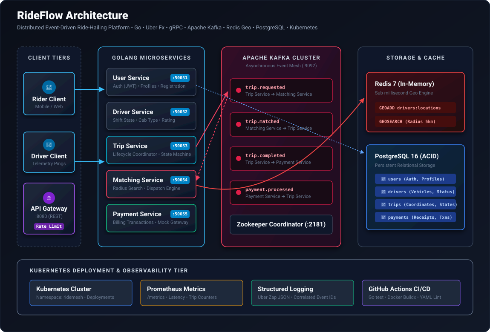

# RideFlow Frontend 🚗⚡

RideFlow Frontend is a dark-mode, map-centric web application engineered in **Next.js 14 (App Router)**, **TypeScript**, and **Tailwind CSS**. It is designed to pair with the **RideFlow Distributed Microservices Backend** (Go, Uber Fx, gRPC, Kafka, Redis, PostgreSQL).



---

## 🎨 Visual Identity & Design System

The UI takes inspiration from modern ride-hailing interfaces (**Umoto**, **Uber Dark**, and **Linear-style glassmorphism**):
* **Typography**:
  - Headings & Branding: `Plus Jakarta Sans` (Geometric, contemporary sans-serif).
  - Micro-copy & Inputs: `Inter` (Optimized for dense UI controls).
  - Telemetries, ETAs & Event Logs: `JetBrains Mono` (Monospaced tabular numbers).
* **Color Tokens**:
  - Obsidian Dark Surface: `#0A0D14`, `#111622`, `#1E2638`.
  - Neon Mint / Emerald Glow: `#00E599` (Primary action accent).
  - Neon Cyan Accent: `#38BDF8` (Route highlights and telemetry).
  - Translucent Glassmorphism with `backdrop-filter: blur(20px)` and subtle glowing borders.

---

## 🚀 Key Features

### 1. Interactive Dark Vector Map (`MapView.tsx`)
* Powered by **MapLibre GL** with high-contrast **Carto Dark Matter** vector tiles.
* 3D angled camera perspective ($45^\circ$ pitch) matching reference designs.
* Glowing neon gradient road polyline layer with animated dashed pulses.
* Top-down 3D vehicle marker that automatically rotates along road headings as it moves.
* Pulsing pickup marker (emerald circle) and destination pin (cyan flag).

### 2. Floating Journey Drawer (`BookingDrawer.tsx`)
* Left floating glassmorphism panel (Umoto style) displaying route origin and destination.
* Quick-switch city routes:
  1. **Silicon Valley**: Palo Alto (Ross Rd) ➔ Mountain View (Googleplex / Moffett Blvd)
  2. **Boston**: Beacon Hill (Beacon St) ➔ Financial District (State St)
  3. **San Francisco**: Mission Dolores ➔ Presidio
* **Horizontal Car Class Selector**:
  - **Volkswagen Passat** (Comfort • $22.45)
  - **Audi A6** (Luxury • $32.00)
  - **Honda CR-V** (SUV • $28.00)
  - **Datsun Go** (Eco • $14.50)
* Dynamic road distance and fare computation engine.
* Glowing **Confirm Order** button with loading and progress states.

### 3. Live Driver Card Tooltip (`DriverCard.tsx`)
* Floating tooltip directly on the map matching reference screenshots:
  - Driver initials avatar (`JC` - Jeromy Conway / `BH` - Bill Harness / `GS` - Goku Son).
  - Vehicle model, license plate number, and star rating ($4.95\star$).
  - Green verified badge and live **ETA pill** (`10 min`).

### 4. End-to-End Trip State Machine (`useTripStore.ts`)
* `IDLE`: Browse routes, toggle car classes, inspect road distance.
* `SEARCHING`: Radar pulse animation: *"Querying Redis Geo for drivers within 5km..."*
* `ASSIGNED`: Matches driver and pops floating driver HUD card.
* `ON_TRIP`: Car traverses route polyline with live percentage progress bar and heading updates.
* `COMPLETED`: Triggers celebration confetti and opens the itemized receipt modal.

### 5. System Architecture & Kafka HUD (`ArchitectureHUD.tsx`)
* Bottom-right slide-over DevTools panel showing:
  - **Live Kafka Events**: Stream of `trip.requested`, `trip.matched`, `trip.completed`, and `payment.processed` messages with expandable JSON payloads.
  - **Go Microservices Topology**: Health and ports for User (`:50051`), Driver (`:50052`), Trip (`:50053`), Matching (`:50054`), Payment (`:50055`), and API Gateway (`:8080`).
  - **Redis Geospatial Cache**: Visualizes `GEOSEARCH` radius queries and driver coordinate indexing.

### 7. Multi-Design Architecture (Umoto • Uber • GoCabs)
The platform includes 3 distinct switchable frontend layouts accessible with a single click from the top navigation bar:
* **Umoto Dark Theme** (Image 1): Docked left sidebar, vibrant mint Passat card, dual-gradient road polyline, and floating driver card (`JC • 10 min`).
* **Uber Dark Theme** (Image 2): Classic Uber sidebar with `Route Details`, class selector (`Business $15`, `Standart $22`, `Premium $30`), and floating white `Route - 2,5 Kilometers` summary card.
* **GoCabs Dashboard** (Image 3): Full web portal navbar (`GOCABS`), `Ride` / `Courier` tab switcher, and vehicle fleet cards (`White Camry`, `Mustang Shelby GT`, `Honda CR-V`).
* **Trip History & Audited Receipts**: Top bar `Trips` drawer showing Kafka-audited trip IDs, timestamps, and payment statuses.

---

## ⚡ Quickstart & Local Development

### Prerequisites
* Node.js v18.0+ 
* npm v9.0+

### Installation & Run
```bash
# Clone the repository
git clone https://github.com/ThalaPravin/rideflow-frontend-.git
cd rideflow-frontend-

# Install dependencies
npm install

# Start the development server (configured on standard port 3000)
npm run dev
```

Open **[http://localhost:3000](http://localhost:3000)** in your browser to experience the application.

---

## 📂 Project Structure

```text
rideflow-frontend-/
├── src/
│   ├── app/
│   │   ├── globals.css         # Glassmorphism, neon shadows, map styles
│   │   ├── layout.tsx          # Plus Jakarta Sans & JetBrains Mono typography
│   │   └── page.tsx            # Main canvas assembling Map & HUD
│   ├── components/
│   │   ├── booking/
│   │   │   ├── BookingDrawer.tsx    # Left floating route & car selection panel
│   │   │   ├── DriverCard.tsx       # Live driver tooltip badge
│   │   │   └── TripReceiptModal.tsx # Completion receipt & confetti
│   │   ├── common/
│   │   │   └── Header.tsx           # Brand bar & city route switcher
│   │   ├── hud/
│   │   │   └── ArchitectureHUD.tsx  # Kafka events stream & Redis inspector
│   │   └── map/
│   │       └── MapView.tsx          # MapLibre GL dark vector map
│   ├── data/
│   │   └── mockData.ts         # Routes, car specs & driver telemetry
│   ├── store/
│   │   └── useTripStore.ts     # Zustand store & lifecycle state machine
│   └── types/
│       └── trip.ts             # TypeScript domain definitions
├── tailwind.config.ts          # Custom dark palette & animations
├── package.json
└── README.md
```
