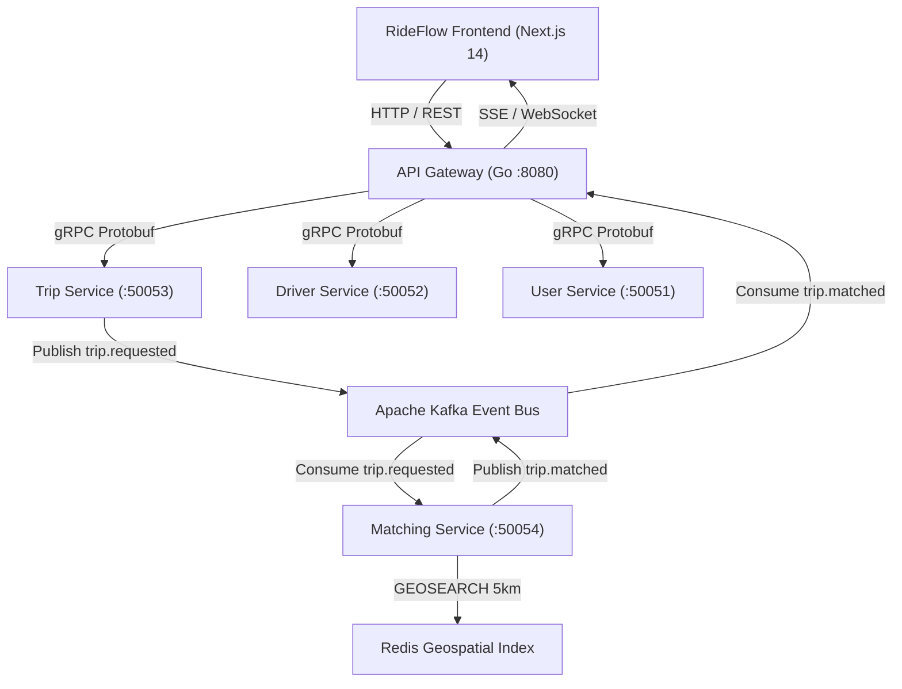

# RideFlow Frontend 🚗⚡

RideFlow Frontend is a production-grade, dark-mode, map-centric web application engineered in **Next.js 14 (App Router)**, **TypeScript**, **Tailwind CSS**, and **MapLibre GL**. It serves as the rich client for the **RideMesh Distributed Microservices Platform** (Go, Uber Fx, gRPC protobufs, Apache Kafka, Redis Geospatial, PostgreSQL).


---

## 🎨 Visual Identity & Multi-Design System

The application faithfully implements the 3 distinct ride-hailing design paradigms requested from reference specifications:

1. **Umoto Dark Theme** (Primary View):
   - Left-docked obsidian sidebar (`#13161F`), glowing lowercase `umoto.` branding.
   - Dotted journey timeline connecting origin (Ross Rd) and destination (Moffett Blvd).
   - High-contrast neon mint (`#2EE59D`) vehicle card with cutout Volkswagen Passat photography.
   - Ambient driver card overlay (`JC • 10 min ETA`) floating on the vector road map.
2. **Uber Dark Theme**:
   - Classic high-contrast dark sidebar with `Route Details` inputs and home/pin icon indicators.
   - Tiered ride class selector (`Business $15`, `Standart $22`, `Premium $30`).
   - Floating white `Route - 2,5 Kilometers` summary card on Boston Beacon Hill canvas.
3. **GoCabs Web Portal**:
   - High-density laptop dashboard navbar with gold typography and notifications.
   - `Ride` vs `Courier` mode tab switcher.
   - Multi-vehicle fleet cards (`White Camry`, `Mustang Shelby GT`, `Honda CR-V`).

---

## 🚀 Key Modules & Capabilities

### 1. Hardware-Accelerated Vector Map (`MapView.tsx`)
* Powered by **MapLibre GL JS** with zero API key dependencies using Carto Dark Matter tiles.
* 3D angled camera perspective ($45^\circ$ pitch, $-20^\circ$ bearing) with smooth toggle controls.
* Animated neon gradient polyline with flowing dashed pulses.
* Top-down metallic sedan model with projected headlight glow cones that smoothly rotates along street headings.
* **Camera Follow Mode**: Dedicated `Crosshair` tracking mode that dynamically locks camera center onto moving vehicles.
* Ambient driver fleet rendered directly from simulated Redis Geospatial caches.

### 2. Live Driver Dispatch Console (`DriverSimulatorModal.tsx`)
* Real-time driver perspective dashboard.
* Incoming dispatch modal with rider profile, pickup location, fare payout, and interactive **"Accept Ride"** / **"Decline"** buttons.
* Shift earnings tracker: Today's revenue (`$164.50`), completed trips counter (`7 trips`), and driver rating (`4.95★`).
* Online/Offline driver availability toggle and GPS emitter directly to backend Redis `GEOADD` sorted sets.

### 3. In-App Messenger (`DriverChatModal.tsx`)
* End-to-end simulated messaging channel between rider and driver.
* Quick-action preset chips (*"I'm waiting at the curb"*, *"Wearing a dark jacket"*, *"Please take express route"*).
* Animated driver typing indicator with contextual automated responses.
* Delivery timestamps and double-check read receipts.

### 4. Safety Toolkit & Emergency SOS (`SafetyToolkitModal.tsx`)
* **4-Digit Safety PIN**: Verification code displayed to passenger to confirm driver identity prior to boarding.
* **Live Trip Sharing**: Copyable real-time tracking link with live GPS coordinates, vehicle plate, and ETA.
* **Emergency Assistance**: One-tap 911 SOS dispatch simulator with automatic emergency location broadcast.

### 5. Saved Places & Bookmarks (`SavedPlacesModal.tsx`)
* Accessible via the top-right bookmark badge.
* Instant one-tap presets for **Home**, **Work / HQ**, **Airport**, **Gym**, and **Coffee**.
* City hotspots for Silicon Valley, Boston Downtown, and San Francisco.
* Instant origin or destination assignment with automatic route polyline re-computation.

### 6. System Architecture & Kafka Inspector HUD (`ArchitectureHUD.tsx`)
* Toggleable floating DevTools cockpit:
  - **Live Kafka Events**: Streaming event envelopes (`trip.requested`, `trip.matched`, `trip.completed`, `payment.processed`) with JSON payload previews.
  - **Microservices Health**: Live connection status, ping latency, and port monitoring for Go services (User `:50051`, Driver `:50052`, Trip `:50053`, Matching `:50054`, Payment `:50055`, API Gateway `:8080`).
  - **Redis GEO Inspector**: Monitored driver coordinates and radius search metrics.

### 7. Mobile Responsive Adaptation
* Adaptive layout gracefully collapses on mobile screens (`< 768px`).
* Floating bottom navigation pill (`[ 🚖 Booking ]` | `[ 🗺️ Map ]`) allowing seamless one-touch toggling on phones.
* Touch-friendly buttons and sheet drawers.

---

## ⚡ Quickstart & Local Setup

### Prerequisites
* **Node.js** v18.0+ 
* **npm** v9.0+

### Run Locally
```bash
# 1. Clone repository
git clone https://github.com/ThalaPravin/rideflow-frontend-.git
cd rideflow-frontend-

# 2. Install dependencies
npm install

# 3. Launch development server on port 3000
npm run dev
```

Visit **[http://localhost:3000](http://localhost:3000)** in your browser.

> [!NOTE]
> RideFlow features a **Hybrid Client Architecture**. If the Go backend (`RideMesh`) is running locally on `http://localhost:8080`, the UI connects directly to live REST and gRPC endpoints. If running standalone, an embedded state simulator automatically powers all microservice interactions, Kafka streams, and driver dispatches!

---

## 📂 Project Structure

```text
rideflow-frontend-/
├── src/
│   ├── app/
│   │   ├── globals.css                # Glassmorphism, neon tokens, mapbox styles
│   │   ├── layout.tsx                 # Plus Jakarta Sans & JetBrains Mono typography
│   │   └── page.tsx                   # Master canvas assembling Map, Drawer & Modals
│   ├── components/
│   │   ├── booking/
│   │   │   ├── BookingDrawer.tsx       # Umoto & Uber route drawers
│   │   │   ├── DriverCard.tsx          # Floating driver HUD badge
│   │   │   ├── GoCabsDashboard.tsx     # GoCabs laptop dashboard view
│   │   │   ├── RouteSummaryCard.tsx    # Bottom route distance badge
│   │   │   ├── SavedPlacesModal.tsx    # One-tap bookmarks & hotspots
│   │   │   ├── TripHistoryModal.tsx    # Past rides & Kafka audited receipts
│   │   │   └── TripReceiptModal.tsx    # Completion receipt & celebration confetti
│   │   ├── chat/
│   │   │   └── DriverChatModal.tsx     # In-app driver messaging
│   │   ├── common/
│   │   │   └── Header.tsx              # Brand bar, sound FX toggle, theme switcher
│   │   ├── driver/
│   │   │   └── DriverSimulatorModal.tsx # Driver dispatch acceptance & shift earnings
│   │   ├── hud/
│   │   │   └── ArchitectureHUD.tsx     # Kafka events stream & Redis inspector
│   │   ├── map/
│   │   │   └── MapView.tsx             # MapLibre GL 3D vector map & camera follow
│   │   └── safety/
│   │       └── SafetyToolkitModal.tsx  # Ride PIN verification & 911 SOS
│   ├── data/
│   │   └── mockData.ts                # City routes, car tiers, and fleet specs
│   ├── services/
│   │   └── api.ts                     # Hybrid Go REST client with simulator fallback
│   ├── store/
│   │   └── useTripStore.ts            # Zustand trip state machine & telemetry
│   ├── types/
│   │   └── trip.ts                    # TypeScript domain models
│   └── utils/
│       └── sound.ts                   # Web Audio synthesized chimes and FX
├── tailwind.config.ts                 # Custom obsidian & emerald neon color palette
├── package.json
└── README.md
```

---

## 🛠️ Microservices Ecosystem Integration



---

## 📄 License
MIT © 2026 Pravin Thala. Built for high-performance distributed systems demonstrations.
